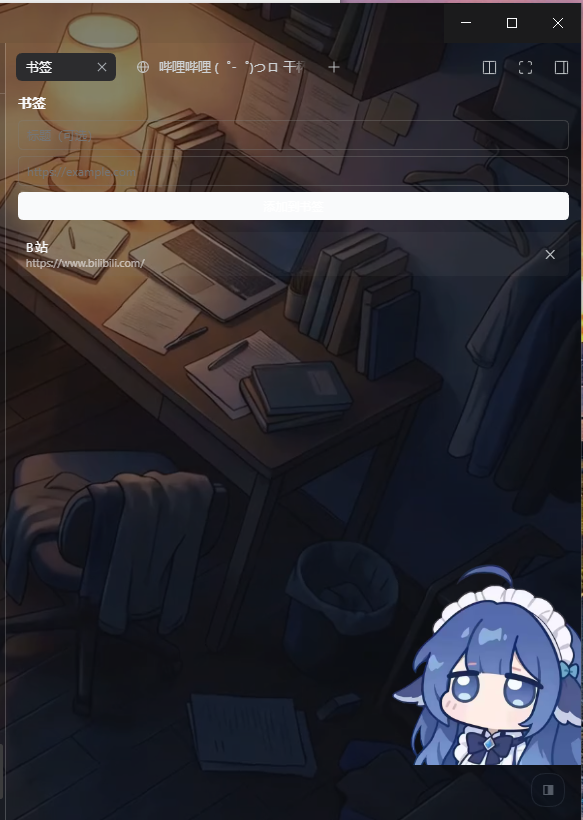

# dsh-sidebar-bookmarks

[](LICENSE)

仓库：<https://github.com/jinlong252577/dsh-sidebar-bookmarks>

A local [DeepSeek Harness](https://github.com/deepseek-ai/deepseek-harness) (DSH) Desktop plugin that adds a **Bookmarks** tab to the right sidebar. Click a bookmark and it opens in DSH's built-in side browser — no system browser jump.

> 给 DSH 右侧栏加一个「书签」标签页：收藏网址，点击直接在侧边浏览器打开。



## 功能

- 右侧栏 `+` →「书签」新增一个标签页，和浏览器 / 文件预览并列；
- 添加（标题可选 + 网址）、删除、点击条目在右侧浏览器打开；
- 书签按会话无关的全局列表保存，关闭标签页、刷新页面、重启 DSH 后仍在；
- 纯浏览器端存储（`localStorage` 优先，cookie 兜底），不依赖宿主路由。

## 兼容性

- DSH Desktop **0.2.1-rc.2**（其他 0.2.x 未验证）；
- desktop profile（`%USERPROFILE%\.dsh\profiles\desktop`）；
- 只支持 `http/https` 网址。

## 安装

### 方式一：手动复制（最稳）

1. 把本仓库放到：

   ```
   %USERPROFILE%\.dsh\profiles\desktop\plugins\dsh-sidebar-bookmarks
   ```

2. 同一份再复制到：

   ```
   %USERPROFILE%\.dsh\profiles\desktop\node_modules\dsh-sidebar-bookmarks
   ```

3. 编辑 `%USERPROFILE%\.dsh\profiles\desktop\package.json`：

   - `dependencies` 加：

     ```json
     "dsh-sidebar-bookmarks": "file:plugins/dsh-sidebar-bookmarks"
     ```

   - `dsh.profile.bundles` 末尾加：

     ```json
     "dsh-sidebar-bookmarks"
     ```

4. 重启 DSH。

### 方式二：从 GitHub 安装

需要本机有 `dsh` CLI，且 profile 允许第三方 bundle：

```sh
dsh plugin --profile desktop add github:jinlong252577/dsh-sidebar-bookmarks
```

> Desktop 的 profile 由 Electron 应用托管，部分版本会拒绝 CLI 直接安装；
> 失败时用方式一手动复制。

## 数据存储

书签保存在浏览器端，**不在本仓库里**：

- `localStorage` 优先（key：`dsh-sidebar-bookmarks:v1`）；
- cookie 分片兜底（`dsh_bm_0..n`，按 `127.0.0.1` 主机保存，不随端口变化）。

因此换电脑或清空浏览器存储后，书签需要重新添加。

## 目录结构

```
.
├─ package.json        # DSH client + bundle 声明
├─ cordis.patch.yml    # 挂载行
├─ lib/
│  ├─ client.js        # 右侧栏标签页 UI 与浏览器端存储
│  └─ index.js         # 宿主半边（本地 HTTP 路由，留作扩展）
├─ README.md
└─ LICENSE
```

## 卸载

1. 从 profile 的 `package.json` 删除 `dsh-sidebar-bookmarks`（dependencies 与 `dsh.profile.bundles`）；
2. 删除 `plugins\dsh-sidebar-bookmarks` 与 `node_modules\dsh-sidebar-bookmarks`；
3. 重启 DSH。

## 已知限制

- 宿主半边（`lib/index.js`）在当前 DSH 版本上未被加载，功能完全走浏览器端；
- 浏览器存储被清空时书签会丢，重要书签建议自行备份；
- 单次容量约 60–100 条（cookie 分片上限）。

## License

[MIT](LICENSE)
